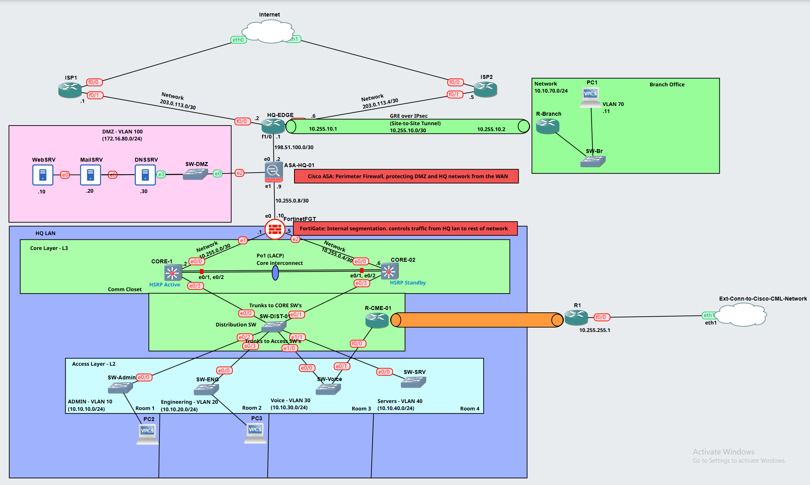
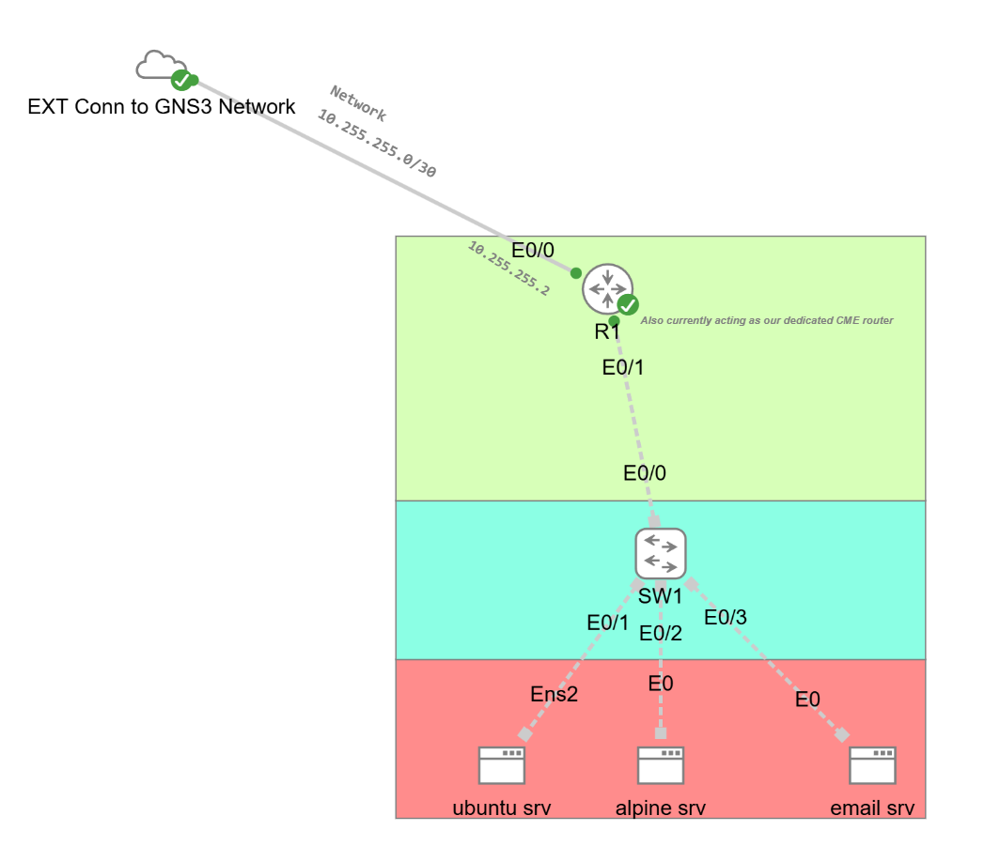

# Enterprise Network & VoIP Lab

Hey, thanks for stopping by!

I'm building this project to get hands-on experience designing, setting up, and troubleshooting an enterprise-style network. I'm using **GNS3** and **VMware Workstation** to create a virtual environment where I can practice the same kinds of networking and security tasks you'd find in a real business.

This is a work in progress, and I'm documenting the process as I go — including the design decisions, configurations, things that break, and how I fix them.

## New to GNS3 or virtualization?

No worries — here's the quick version.

**GNS3** is a program that lets you build a computer network on your PC without needing a room full of physical routers, switches, and firewalls. You add virtual versions of network devices to a workspace, connect them with virtual cables, and then configure them much like you would real equipment. You can practice things like VLANs, routing, firewalls, and troubleshooting in that virtual environment.

**Virtualization** is the technology that lets one physical computer run multiple separate computers, called *virtual machines (VMs)*. Each VM behaves like its own computer, with its own operating system and virtual network connections.

For this project, I'm using:

- **GNS3** to create the network topology and connect the virtual network devices.
- **VMware Workstation** to run virtual machines, including the GNS3 virtual machine and a Windows 11 endpoint.
- **Virtual network adapters and links** to connect the VMs to the lab, so they can communicate with the routers, switches, and firewalls.

Think of it like building a small IT environment inside one physical PC. The routers, switches, firewalls, servers, and computers are virtual, but the configuration and troubleshooting skills are very similar to working with physical equipment.

You don't need to know GNS3 or virtualization to follow along. I'll document the setup, explain the purpose of each part, and include diagrams, configurations, screenshots, and test results as the project develops.

## Topology design resource

I'm using **[draw.io (diagrams.net)](https://www.drawio.com/)** to create the network topology diagrams for this project and my future lab designs. It's free to use, and the desktop application is free to download. I plan to keep the editable `.drawio` source files alongside exported images so the diagrams can be updated as the lab changes.

## Image resources

Some of the Cisco images used for this lab were found in this GitHub repository:

**[Cisco Images for GNS3 and EVE-NG](https://github.com/hegdepavankumar/Cisco-Images-for-GNS3-and-EVE-NG)**

This is a third-party resource. I'm linking to the original page rather than hosting those image files here. Check the repository's own terms and any vendor licensing requirements before downloading or using an image.

## Current topology and starting design

**Current starting baseline:** Enterprise Network Baseline v1.4.

Baseline v1.4 is the current design reference for the initial configuration of the enterprise lab. It brings together dual ISP links, the HQ edge router, Cisco ASA perimeter firewall, FortiGate internal segmentation firewall, a DMZ, redundant Layer 3 core switches using HSRP, the distribution and access layers, a branch office connected through GRE over IPsec, and the dedicated VoIP network.

The updated diagram also shows the GNS3-to-Cisco CML lab connection through the external connector and transit router. This integration is documented separately in the [Cisco CML–GNS3 Transit Network repository](https://github.com/MaloneNetworks/Cisco-CML_GNS3-Transit-Network). That project records the VMware LAN Segment, Cisco CML bridge, GNS3 Cloud connection, and successful bidirectional router-to-router testing across the `10.255.255.0/30` transit link. The separate repository contains the detailed transit build steps, while this repository remains the home for the enterprise/VoIP network design and configuration.

The topology and cut sheet are the starting references for the build. They document the intended layout, device roles, interface connections, VLANs, subnets, gateways, and addressing. They do not mean that every device, routing protocol, firewall policy, redundancy feature, VPN, or service has already been configured and verified. Those items will be implemented and tested in stages, with progress recorded as the lab develops.






**Design references:**

- [Enterprise Network Baseline v1.4 – Topology](01-design/topology/Enterprise_Network_BASELINE_v1.4.png) — visual layout, device placement, and network connections.
- [Enterprise Network Cut Sheet](01-design/topology/Enterprise%20Network%20Cut%20Sheet.png) — VLANs, subnetting, gateways, WAN addressing, firewall interfaces, server addressing, and device inventory.
- [Cisco CML–GNS3 Integration Diagram](01-design/topology/Cisco-CML-GNS3-Integration.png) — the external connector, transit router, switch, and server connections for the separate lab integration.
- [Topology documentation](01-design/topology/README.md) — baseline scope and diagram status.
- [IP addressing and VLAN plan](01-design/ip-addressing.md) — detailed addressing reference.
- [Port mapping](01-design/port-mapping.md) — interface assignments and connection endpoints.

Previous design snapshots are retained for reference: [v1.3](01-design/topology/Enterprise_Network_BASELINE_v1.3.png), [v1.2](01-design/topology/Enterprise_Network_BASELINE_v1.2.png), [v1.1](01-design/topology/Enterprise_Network_BASELINE_v1.1.png), and the earlier [topology v2.0 snapshot](01-design/topology/v2.0.png).

## What I'm building

The goal is to create a network that brings several technologies together:

- **Switching and VLANs** — separate departments and devices into their own networks.
- **Routing and redundancy** — connect the networks and practice keeping things online when a link or device fails.
- **Firewalls and network security** — I'm deliberately using both a **Cisco ASA** and a **FortiGate** so I can get hands-on experience with both firewall platforms. I want to learn their different interfaces, configuration methods, security policies, NAT, and troubleshooting workflows rather than limiting the project to just one vendor.
- **DMZ and servers** — create a separate network for services that need to be reachable from outside.
- **Branch connectivity** — connect a remote office to the main site and practice VPN technologies.
- **VoIP** — build a voice network using Cisco Call Manager Express (CME) and a Windows softphone.
- **VM bridge** — connect a Windows virtual machine to the GNS3 network so it can act like a real computer plugged into one of the lab switches.

## What is the VM bridge?

A **VM bridge** is the connection that lets a virtual machine communicate with devices in the network lab. In this project, I plan to connect a Windows 11 VM in VMware Workstation to a VMware LAN Segment named `VOIP-LAB`. That segment will connect through the GNS3 VM's network adapter and a GNS3 Cloud node into the voice switch.

In simple terms, it makes the Windows VM behave like a computer plugged into the lab with an Ethernet cable. That means I can use it to test network access and, eventually, run a softphone and make calls through the VoIP setup.

The planned path is:

```text
Windows 11 VM
    |
VMware LAN Segment: VOIP-LAB
    |
GNS3 VM network adapter (eth1)
    |
GNS3 Cloud node
    |
SW-Voice
    |
Voice VLAN 30
    |
CME router
```

This connection is still being built and tested. The Windows VM will keep its separate NAT adapter for normal internet access; the lab connection is intended to stay separate from the home network.

## Tools and environment

| Tool / platform | How I'm using it |
|---|---|
| GNS3 | Build and run the network topology |
| Cisco CML Personal | Access to 20 Cisco virtual images for building and testing Cisco network labs |
| VMware Workstation | Run the GNS3 environment and Windows endpoint VM |
| Cisco IOS IOU L2/L3 | Practice switching, VLANs, routing, and redundancy |
| Cisco ASA | Practice firewall rules, NAT, and DMZ security |
| FortiGate | Get hands-on experience with Fortinet firewall administration |
| Cisco 3745 | Evaluate as the router for the CME/VoIP portion |
| Windows 11 | Host the planned softphone endpoint |
| Python (planned) | Automate controlled network faults for daily troubleshooting practice |

Some devices are already placed and connected in GNS3. The network has not been fully configured yet, so the addressing and feature details below are still a working design.

## Current design

The voice portion is planned around:

| Item | Current plan |
|---|---|
| Voice VLAN | VLAN 30 |
| Voice subnet | `10.10.30.0/24` |
| Proposed voice gateway | `10.10.30.1` |
| Proposed CME address | `10.10.30.10` |
| Windows VM | `VOIP-PHONE-01` |
| VMware network segment | `VOIP-LAB` |

These values are not all configured or verified yet. I'll update the documentation as the design is tested and finalized.

## Daily network troubleshooting exercise

I don't just want to build the network and leave it running. I want to use it as a daily troubleshooting workout.

The plan is to write a **Python script**, or a similar automation tool, that can introduce one controlled problem into the lab. For example, it could put a switch port in the wrong VLAN, remove a VLAN from a trunk, change a route, cause an HSRP problem, or add a firewall rule that blocks traffic.

My daily routine will look like this:

1. Log in to the lab and start the network.
2. Run the script to introduce one planned fault.
3. Use the symptoms, command output, and connectivity tests to figure out what is broken.
4. Fix the problem myself without being told the answer.
5. Run checks to prove the network is working again.
6. Save my notes and results, then shut down or log off from the lab.

The goal is to make this a repeatable daily exercise: log in, find the problem, fix it, verify the repair, and log off. Over time, I can rotate through different faults and make the exercises harder.

The script will be designed to work only inside this isolated GNS3 lab. It should use a list of known, reversible faults rather than make random changes with no safety checks. I'll keep known-good configurations, include a way to reset the lab, and record which fault was used. I don't want the script touching my home network, physical network adapters, or anything outside the lab.

This automation is a planned feature, not something that is already built. I'll work on it after the main network is configured, tested, and backed up.

## How I'm approaching the project

I'm building this in stages so I can test each part before moving on:

1. Document the devices, interfaces, and existing connections.
2. Finalize the IP addressing and VLAN plan.
3. Configure the core, distribution, and access switching.
4. Set up routing and gateway redundancy.
5. Configure the ASA, FortiGate, and DMZ.
6. Bring up the branch connection.
7. Validate the CME router and connect the Windows softphone.
8. Test connectivity, security policies, failover, and VoIP calls.
9. Build the repeatable Python troubleshooting exercises and document the results.

## Lab documentation

I've organized the documentation into numbered sections so it's easier to find the information needed to build, configure, and troubleshoot the lab.

- [Project overview](00-start-here/project-overview.md) — project goals, scope, and current state.
- [Topology and diagrams](01-design/topology/README.md) — network diagrams and design snapshots.
- [Device inventory](01-design/device-inventory.md) — device images, software versions, and capabilities.
- [IP addressing and VLAN plan](01-design/ip-addressing.md) — VLAN networks and planned addresses.
- [Port mapping](01-design/port-mapping.md) — cable endpoints and interface assignments.
- [First-time lab startup instructions](02-build/lab-instructions.md) — how to open, start, operate, and safely shut down the lab.
- [Build instructions](02-build/BUILD-INSTRUCTIONS.md) — ordered device configuration steps and verification commands.
- [Implementation roadmap](02-build/implementation-roadmap.md) — build stages and progress.
- [Lab guide](02-build/LAB-GUIDE.md) — project goals, network layout, technologies, and how the pieces fit together.
- [VoIP documentation](04-voip/README.md) — CME, extension directory, and Windows softphone setup.
- [Test plan](05-testing/test-plan.md) — test cases and verification results.
- [Network Chaos Lab](06-troubleshooting/network-chaos-lab/README.md) — planned controlled troubleshooting exercises.
- [Daily logs and screenshots](07-logs-evidence/) — build notes and milestone evidence.

For a quick overview of every section, use the [repository guide](00-start-here/README.md).

The design records have separate jobs: the IP/VLAN plan is the source of truth for addressing, the port register owns cable endpoints, and the device inventory owns device details. The topology and cut sheet are the current design references and will be updated whenever the actual GNS3 layout changes. Planned values will stay marked as draft until verified.

## A note on project status

This is an independent learning project. The topology is being prepared, and the configuration and testing work is still ahead. I'll distinguish planned features from features that are actually implemented and verified.

## Check out my other labs & share feedback

This is one of my hands-on projects, and I'll be adding more labs and experiments as I continue learning. Feel free to check out my other repositories and projects on my [GitHub profile](https://github.com/MaloneNetworks). You can also connect with me or reach out on [LinkedIn](https://www.linkedin.com/in/darrellmalone9107/).

If you spot something I could improve, have a different way of approaching a configuration, or just have feedback, I'd love to hear it. Open an issue or start a discussion in the repository. I'm always looking to learn, improve the lab, and hear how other people would tackle the same challenges.

Thanks for checking out my work!
